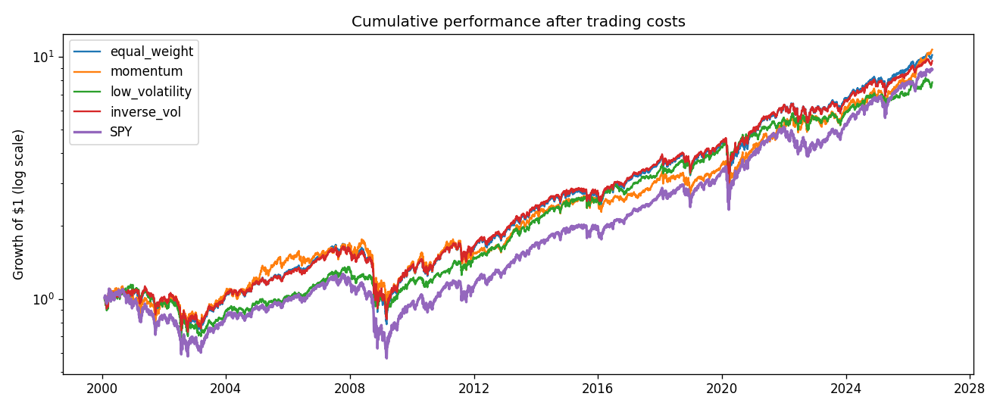

# Sector Rotation & Portfolio Risk Backtest

A monthly-rebalanced backtest of four rules-based portfolios across the nine original US sector ETFs
(1999 to today), measured against the S&P 500 (SPY) after trading costs: equal weight, 12-1 month momentum,
low volatility and inverse-volatility weighting. Reports return, volatility, Sharpe, maximum drawdown,
beta, alpha, Value-at-Risk and expected shortfall, with robustness checks across sub-periods,
trading costs and momentum lookbacks.

**Report:** [reports/backtest_report.md](reports/backtest_report.md)



## Key results
- 26.7 years (Feb 2000 - Oct 2026), monthly rebalance, 10 bp cost: every sector portfolio beat SPY on a risk-adjusted basis (Sharpe ~0.47 vs 0.42; equal weight 9.1% vs 8.5% a year).
- Rotation added no reliable edge over equal weight: Sharpe ratios within 0.01, and the top strategy trailed equal weight by 0.3%/yr (t = -1.10).
- Low volatility cut risk: volatility 14.9%, beta 0.65, max drawdown -40% vs -55% for SPY, at a lower return (8.0%).
- Momentum had the highest return (9.3%) but 5.4x annual turnover: Sharpe fell from 0.49 to 0.35 as costs rose to 50 bp, and to 0.39 with a 6-month lookback.

## How it works
1. **Data** (`src/data.py`): daily dividend-adjusted closes for XLB, XLE, XLF, XLI, XLK, XLP, XLU, XLV, XLY and SPY,
   plus 13-week T-bill yields, from Yahoo Finance; saved to `data/processed/prices.csv`.
2. **Rules** (`src/strategies.py`): each uses only prices up to the rebalance date.
3. **Backtest** (`src/backtest.py`): rebalance at each month-end close, weights drift during the month,
   costs charged on turnover.
4. **Metrics** (`src/metrics.py`): CAGR, volatility, Sharpe (over T-bills), max drawdown, Calmar, beta and alpha vs SPY,
   information ratio, 95% historical and normal VaR, expected shortfall, worst month, turnover; t-stat of excess
   monthly return vs equal weight.
5. **Robustness**: three sub-periods, 0/10/25/50 bp costs, 6/9/12-month momentum lookbacks.
6. **Tests** (`tests/`): known metric values, valid weights, a no-look-ahead test (changing future prices must not
   change today's weights), cost effect, and a hand-calculated month of equal-weight returns.

## Run it yourself
```bash
python3.11 -m venv .venv
source .venv/bin/activate
pip install -r requirements.txt
pytest -q
python3 run.py
```
Delete `data/processed/prices.csv` to download fresh prices.

## Limits
Four strategies were compared, so the winner partly reflects selection; results ignore taxes and spreads beyond the
cost assumption; past sector behaviour may not repeat.
