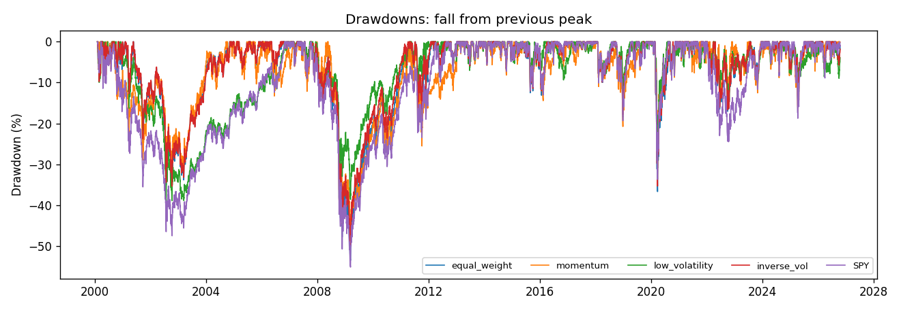
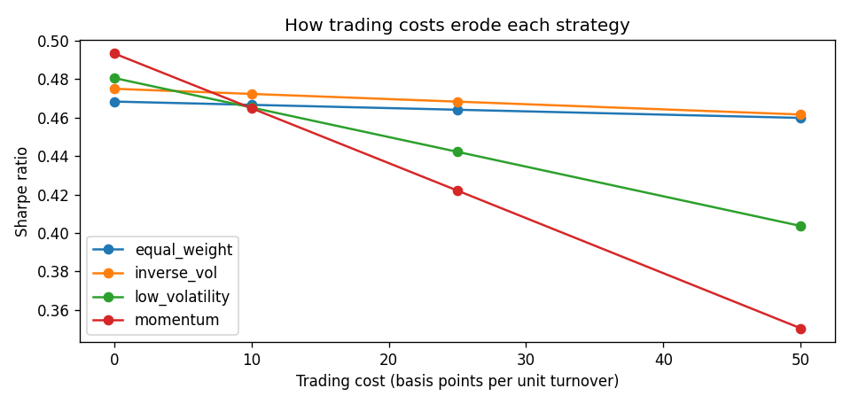

# Sector Rotation & Portfolio Risk Backtest

## 1. Key findings
- Backtest 2000-02-01 to 2026-10-15 (26.7 years), monthly rebalance, 10 bp trading cost per unit of turnover.
- SPY: CAGR 8.5%, volatility 19.2%, Sharpe 0.42, max drawdown -55.2%, beta 1.00
- equal_weight: CAGR 9.1%, volatility 18.1%, Sharpe 0.47, max drawdown -53.5%, beta 0.91, turnover 0.3x/yr
- momentum: CAGR 9.3%, volatility 18.9%, Sharpe 0.46, max drawdown -46.6%, beta 0.87, turnover 5.4x/yr
- low_volatility: CAGR 8.0%, volatility 14.9%, Sharpe 0.47, max drawdown -40.2%, beta 0.65, turnover 2.3x/yr
- inverse_vol: CAGR 8.9%, volatility 17.0%, Sharpe 0.47, max drawdown -50.1%, beta 0.85, turnover 0.5x/yr
- Best risk-adjusted: inverse_vol; vs equal weight its excess return is -0.3%/yr with t = -1.10.
- Daily 95% VaR / expected shortfall: SPY 1.9% / 2.9%, inverse_vol 1.6% / 2.6%.
- Momentum Sharpe by cost: 0 bp → 0.49, 10 bp → 0.46, 25 bp → 0.42, 50 bp → 0.35; by lookback: 6m → 0.39, 9m → 0.44, 12m → 0.46.

### Analyst commentary
<!-- COMMENTARY -->
Over 26.7 years after costs, every sector portfolio slightly beat SPY on a risk-adjusted basis (Sharpe about 0.47 vs 0.42), mostly through diversification: equal weight earned 9.1% a year vs 8.5% with a smaller worst drawdown, likely because SPY was concentrated in technology before the 2000-02 crash. The rotation rules themselves added nothing reliable over simply holding all nine sectors: Sharpe ratios were within 0.01 of each other, and the top-ranked strategy trailed equal weight by 0.3% a year (t = -1.10). Low volatility mainly reduced risk rather than raising return, with volatility of 14.9%, a beta of 0.65 and a maximum drawdown of -40% vs -55% for SPY. Momentum had the highest return (9.3%) but traded 5.4 times a year, so its Sharpe fell from 0.49 to 0.35 as costs rose to 50 bp, and it weakened with a 6-month lookback, so I would not rely on it without cheaper execution and an out-of-sample test. For an investor, the practical lesson is that diversification and risk control did the work, not clever sector timing._
<!-- COMMENTARY -->

## 2. Performance and risk (after costs)
| strategy | cagr | volatility | sharpe | max_drawdown | calmar | beta_vs_spy | alpha_annual | info_ratio | var95_daily | es95_daily | worst_month | turnover_per_year |
| --- | --- | --- | --- | --- | --- | --- | --- | --- | --- | --- | --- | --- |
| equal_weight | 0.091 | 0.181 | 0.467 | -0.535 | 0.17 | 0.905 | 0.011 | 0.061 | 0.017 | 0.027 | -0.169 | 0.307 |
| momentum | 0.093 | 0.189 | 0.465 | -0.466 | 0.2 | 0.868 | 0.017 | 0.072 | 0.019 | 0.028 | -0.149 | 5.385 |
| low_volatility | 0.08 | 0.149 | 0.465 | -0.402 | 0.2 | 0.652 | 0.016 | -0.112 | 0.014 | 0.022 | -0.124 | 2.282 |
| inverse_vol | 0.089 | 0.17 | 0.472 | -0.501 | 0.177 | 0.847 | 0.012 | -0.013 | 0.016 | 0.026 | -0.158 | 0.456 |
| SPY | 0.085 | 0.192 | 0.423 | -0.552 | 0.154 | 1.0 | -0.0 | nan | 0.019 | 0.029 | -0.165 | 0.0 |

## 3. Robustness
### Sub-periods
| period | strategy | cagr | sharpe | max_drawdown |
| --- | --- | --- | --- | --- |
| 1999-2009 | equal_weight | 0.03 | 0.118 | -0.535 |
| 1999-2009 | momentum | 0.034 | 0.137 | -0.466 |
| 1999-2009 | low_volatility | 0.018 | 0.029 | -0.402 |
| 1999-2009 | inverse_vol | 0.031 | 0.116 | -0.501 |
| 1999-2009 | SPY | -0.005 | -0.03 | -0.552 |
| 2010-2019 | equal_weight | 0.126 | 0.865 | -0.185 |
| 2010-2019 | momentum | 0.099 | 0.644 | -0.255 |
| 2010-2019 | low_volatility | 0.136 | 1.1 | -0.129 |
| 2010-2019 | inverse_vol | 0.127 | 0.909 | -0.178 |
| 2010-2019 | SPY | 0.135 | 0.895 | -0.193 |
| 2020-now | equal_weight | 0.132 | 0.602 | -0.367 |
| 2020-now | momentum | 0.176 | 0.768 | -0.303 |
| 2020-now | low_volatility | 0.095 | 0.46 | -0.309 |
| 2020-now | inverse_vol | 0.12 | 0.559 | -0.353 |
| 2020-now | SPY | 0.154 | 0.675 | -0.337 |

### Trading costs
| strategy | cost_bps | cagr | sharpe |
| --- | --- | --- | --- |
| momentum | 0 | 0.099 | 0.493 |
| low_volatility | 0 | 0.083 | 0.481 |
| inverse_vol | 0 | 0.089 | 0.475 |
| equal_weight | 0 | 0.091 | 0.468 |
| momentum | 10 | 0.093 | 0.465 |
| low_volatility | 10 | 0.08 | 0.465 |
| inverse_vol | 10 | 0.089 | 0.472 |
| equal_weight | 10 | 0.091 | 0.467 |
| momentum | 25 | 0.084 | 0.422 |
| low_volatility | 25 | 0.077 | 0.442 |
| inverse_vol | 25 | 0.088 | 0.468 |
| equal_weight | 25 | 0.09 | 0.464 |
| momentum | 50 | 0.07 | 0.35 |
| low_volatility | 50 | 0.071 | 0.404 |
| inverse_vol | 50 | 0.087 | 0.462 |
| equal_weight | 50 | 0.09 | 0.46 |

### Momentum lookback
| lookback_months | cagr | sharpe | max_drawdown |
| --- | --- | --- | --- |
| 6 | 0.078 | 0.394 | -0.456 |
| 9 | 0.088 | 0.437 | -0.49 |
| 12 | 0.093 | 0.465 | -0.466 |

## 4. Method notes
- Universe: nine SPDR sector ETFs (adjusted for dividends); benchmark SPY; risk-free rate from 13-week T-bill yields.
- Signals use only prices up to each month end; trades happen at that close and returns start the next day (tested in `tests/`).
- Weights drift with prices during the month; turnover = sum of absolute weight changes at rebalance; cost charged on turnover.
- Sharpe uses excess return over T-bills; VaR and expected shortfall are historical, daily, 95%; a normal-distribution VaR is reported for comparison.
- Limits: four strategies were compared, so the best result is partly selection; ETFs have short histories relative to market cycles; taxes and bid-ask spreads beyond the cost assumption are ignored.
